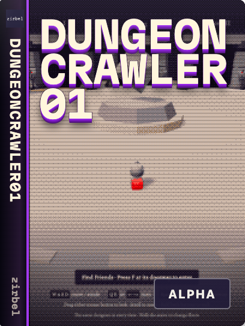

# dungeoncrawler01



**Status:** Alpha

A solo Alpha with a gathering hub, a generated two-floor KayKit dungeon and retained room layouts.
Combat, loot, saved progress and multiplayer remain planned.

## Run

Use Node.js 24 or newer and npm.

```sh
npm ci --ignore-scripts
npm run dev                # http://127.0.0.1:5184
```

WASD moves; Q/E turns; drag looks; wheel zooms; Space hops.
Choose a layout and seed, approach Friends and press F. Climb the stairs to the upper lookout.
The Camera menu offers WoW, Diablo, Zelda, top-down and side inspection views.
Return down the stairs to the green marker and press F for the hub.

## Develop

```sh
npm run verify             # formatting, strict types, rules tests and build
npm run test:browser       # running dev server and Chrome required
```

Set `CHROME_PATH` if Chrome is outside its default location.
Read [AGENTS.md](AGENTS.md), [contributing](CONTRIBUTING.md) and [security](SECURITY.md).

## Docs

- [Contract](CONTRACT.md): implemented behavior and ownership.
- [Current playcheck](PHASE3_PLAYCHECK.md): seeds, stairs, camera views and return checks.
- [Building blocks](BUILDING_BLOCKS.md) and [asset plan](KAYKIT_ASSET_PLAN.md): future scope.
- [Publication](publish/README.md): retained versions and deployment evidence.

## License

Code: [MIT](LICENSE). [Credits](CREDITS.md) and [asset audit](docs/ASSET_LICENSE_AUDIT.md) identify other licenses.
Selected models, fonts, licenses and build tools are included in this standalone repository.
No audio ships in this Alpha.
